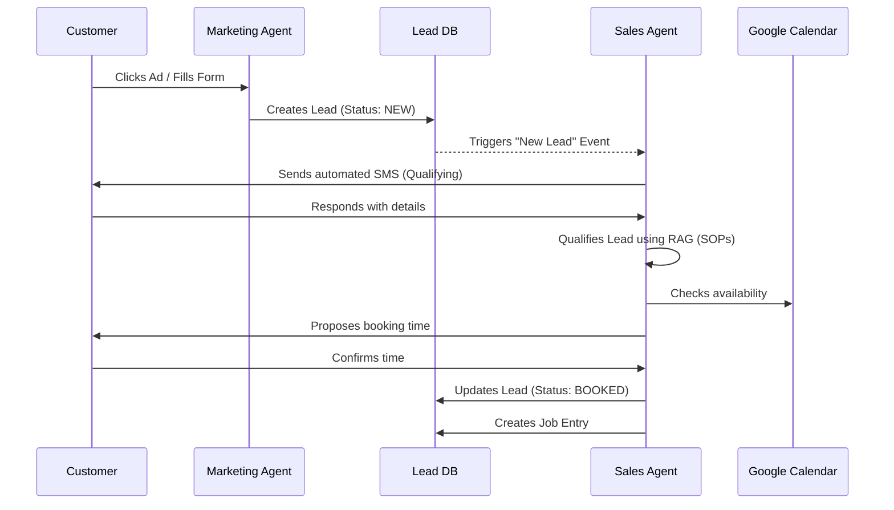
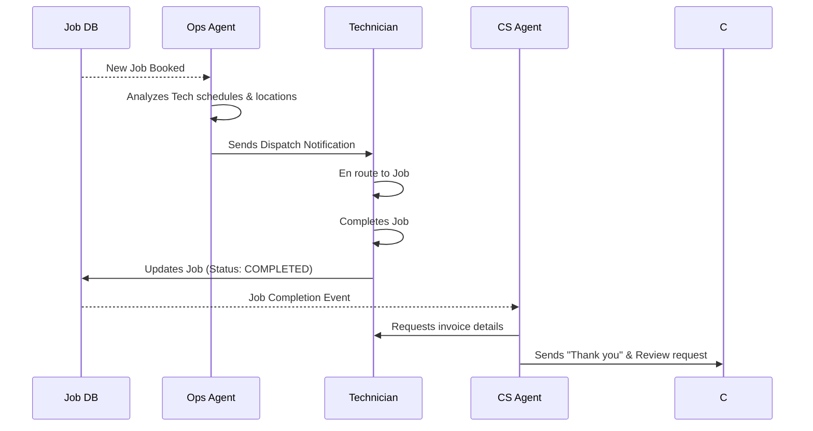

# ServAI System Architecture

## 1. Overview
ServAI is an autonomous AI-driven operating system for home service businesses. The architecture is designed for scalability, multi-tenancy, and high reliability, enabling specialized AI agents to manage business operations with minimal human intervention.

## 2. Component Architecture

### 2.1 Backend Services (FastAPI)
The backend is structured into several logical modules:
- **API Gateway & Auth**: Entry point for all requests. Handles JWT validation and RBAC.
- **Agent Orchestrator**: The "brain" that manages agent lifecycles, task delegation, and inter-agent communication.
- **Core Business API**: Manages domain entities like Leads, Jobs, Invoices, and Customers.
- **Integration Engine**: A plugin-based system for third-party integrations (ServiceTitan, QuickBooks, Stripe, Twilio).
- **Knowledge & RAG Service**: Manages document ingestion, embedding, and vector search.

### 2.2 Frontend (Next.js)
- Modern SaaS dashboard for business owners to monitor agents and view real-time metrics.
- Built-in chat interface for interacting with the AI CEO or other agents.
- Real-time updates via WebSockets.

## 3. Data Architecture

### 3.1 Relational Database (PostgreSQL)
Primary store for structured data. All tables include a `business_id` for multi-tenancy.

#### 3.1.1 Core Tables
- **businesses**: `id` (UUID), `name` (TEXT), `industry` (TEXT), `timezone` (TEXT), `created_at` (TIMESTAMPTZ), `updated_at` (TIMESTAMPTZ).
- **users**: `id` (UUID), `business_id` (UUID), `email` (TEXT), `hashed_password` (TEXT), `role` (OWNER, MANAGER, TECH), `is_active` (BOOL).
- **customers**: `id` (UUID), `business_id` (UUID), `first_name` (TEXT), `last_name` (TEXT), `phone` (TEXT), `email` (TEXT), `address` (JSONB).
- **leads**: `id` (UUID), `business_id` (UUID), `customer_id` (UUID), `status` (NEW, QUALIFYING, BOOKED, DEAD), `source` (TEXT), `summary` (TEXT).
- **jobs**: `id` (UUID), `business_id` (UUID), `lead_id` (UUID), `assigned_tech_id` (UUID), `scheduled_at` (TIMESTAMPTZ), `status` (SCHEDULED, IN_PROGRESS, COMPLETED, CANCELLED), `description` (TEXT).
- **invoices**: `id` (UUID), `business_id` (UUID), `job_id` (UUID), `amount` (DECIMAL), `status` (DRAFT, SENT, PAID, VOID), `due_at` (TIMESTAMPTZ).

#### 3.1.2 Agent & Interaction Tables
- **agents**: `id` (UUID), `business_id` (UUID), `agent_type` (CEO, SALES, CS, OPS, MARKETING, REPUTATION, FINANCE), `status` (IDLE, WORKING, SLEEPING), `config` (JSONB).
- **conversations**: `id` (UUID), `business_id` (UUID), `customer_id` (UUID), `channel` (SMS, CALL, CHAT), `status` (OPEN, CLOSED).
- **messages**: `id` (UUID), `conversation_id` (UUID), `sender_type` (CUSTOMER, AGENT, SYSTEM), `sender_id` (UUID), `content` (TEXT), `metadata` (JSONB), `created_at` (TIMESTAMPTZ).
- **tasks**: `id` (UUID), `business_id` (UUID), `assigned_to_agent_id` (UUID), `title` (TEXT), `description` (TEXT), `status` (PENDING, IN_PROGRESS, COMPLETED, FAILED), `result` (JSONB).

### 3.2 Vector Database (pgvector)
Used for RAG (Retrieval-Augmented Generation).
- **knowledge_bases**: `id` (UUID), `business_id` (UUID), `name` (TEXT), `description` (TEXT).
- **knowledge_documents**: `id` (UUID), `kb_id` (UUID), `content` (TEXT), `embedding` (VECTOR(1536)), `metadata` (JSONB).

### 3.3 Cache & Message Broker (Redis)
- **Pub/Sub**: Channel `business:{id}:events` for real-time dashboard updates.
- **Task Queue**: Celery workers for heavy processing (e.g., voice synthesis, external API sync).

## 4. API Specification

### 4.1 Authentication
- `POST /api/v1/auth/login`: Authenticate user and return JWT.
- `POST /api/v1/auth/refresh`: Refresh expired JWT.

### 4.2 Lead Management
- `GET /api/v1/leads`: List all leads for the business.
- `POST /api/v1/leads`: Manually create a lead.
- `GET /api/v1/leads/{id}`: Get lead details.
- `PATCH /api/v1/leads/{id}`: Update lead status/details.

### 4.3 Agent Interactions
- `GET /api/v1/agents`: List all agents and their current status.
- `POST /api/v1/agents/{id}/command`: Send a manual command to an agent.
- `GET /api/v1/conversations`: List active customer conversations.
- `POST /api/v1/conversations/{id}/message`: Send a message via an agent.

### 4.4 Knowledge Base
- `POST /api/v1/knowledge/upload`: Upload PDF/TXT for RAG ingestion.
- `GET /api/v1/knowledge/search`: Test RAG retrieval.

### 4.5 WebSockets
- `WS /ws/v1/realtime`: Real-time stream of agent actions, customer messages, and system alerts.

## 5. Agent Workflows

### 5.1 Lead Processing Workflow (Marketing -> Sales)

### 5.2 Dispatching & Ops Workflow

## 6. Data Flow

1.  **Ingestion**: Leads enter via Integration Engine (Twilio, Webhooks, Google LSA).
2.  **Qualification**: Sales Agent retrieves context from Knowledge Service (Business SOPs) and engages customer.
3.  **Action**: Once qualified, Sales Agent interacts with Job DB and external Calendar/Scheduling tools.
4.  **Monitoring**: CEO Agent monitors KPIs (Booking Rate, CAC) from DB and sends daily summaries to the Dashboard via WebSockets.
5.  **Reconciliation**: Finance Agent watches for Completed Jobs, generates invoices via Stripe/QuickBooks, and follows up on payments.

## 7. Security & Multi-tenancy
- **Row Level Security (RLS)**: Enforced via PostgreSQL policies where possible.
- **Encrypted Storage**: Third-party API keys stored in `businesses` table are encrypted using a per-tenant master key.
- **Audit Logging**: Every LLM call and agent action is logged to `agent_logs` with a reference to the `business_id` and `user_id` (if applicable).

## 8. Deployment Strategy
- **Docker Compose**: For local development.
- **Kubernetes**: For production (EKS/GKE).
- **CI/CD**: GitHub Actions for automated linting, testing, and deployment to staging/production.
